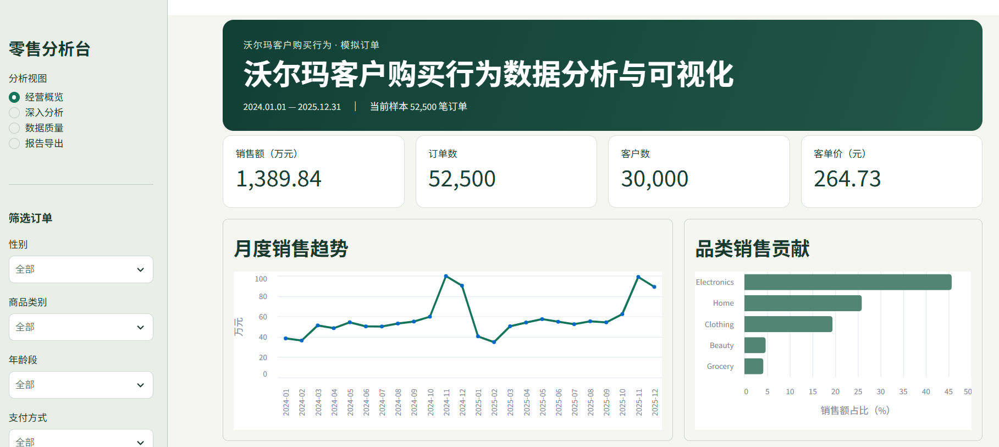
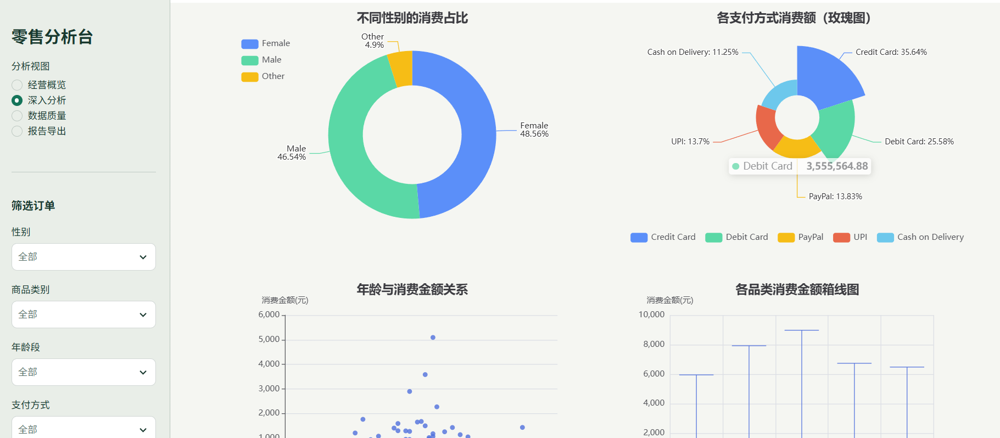

# 沃尔玛客户购买行为数据分析与可视化

使用 Python、pandas、Streamlit 和 pyecharts 分析 **模拟零售订单**。数据由课程实训脚本生成，不代表沃尔玛真实经营数据。

## 运行

需要 Python 3.10 或更高版本。Windows 直接双击「启动看板.bat」即可（脚本会自动找到可用的虚拟环境；本目录没有 `.venv` 时会复用同级「大数据实训」的 `.venv`，找不到才新建）。

也可以手动运行：

```bash
python -m venv .venv
# Windows: .venv\Scripts\activate
# macOS / Linux: source .venv/bin/activate
python -m pip install -r requirements.txt
python -m streamlit run app.py
```

> 如果提示 `No module named 'streamlit'`，说明用错了解释器：请选 `.venv\Scripts\python.exe`，而不是系统自带的 Python。

## 看板与指标

- **经营概览**：按日期、城市、品类等筛选销售趋势和品类贡献。
- **深入分析**：查看分组汇总、交叉分析与 12 张图表（可切到「图表浏览」页签）。
- **数据质量**：检查原始字段、缺失值、重复记录及异常金额。异常金额只打标记、**保留原始金额**用于汇总，避免少计销售额。
- **报告导出**：下载 CSV、Excel 和分析结论。导出 Excel 时回读核对订单数与金额。

全量模拟数据去重后有 52,500 笔订单、30,000 位客户，总销售额为 13,898,405.08 元。复购订单占比为 42.86%，所选范围内至少下单两次的客户占 55.50%；金额异常（缺失、0 元/负数、超过 99.5% 分位）共标记 271 条。

## 界面预览

**经营概览**



**深入分析 · 图表浏览**



命令行运行 `python run_pipeline.py` 会在 `outputs/` 生成明细、报表和图表。加 `--no-export` 可仅运行分析。部分深入分析图表需要联网加载 ECharts。
